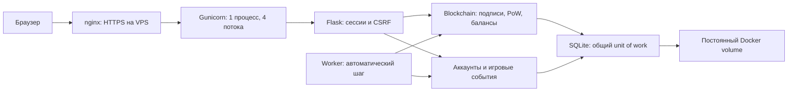

# Архитектура OilCoin

Подробные форматы, байты подписываемого сообщения, расчёт балансов и пошаговый опыт с повреждённой цепочкой разобраны в [руководстве по блокчейну](BLOCKCHAIN.md). Здесь описана связь блокчейна с остальными частями приложения.

## 1. Что является блокчейном, а что — инфраструктурой

Блокчейн — последовательность блоков, где каждый блок содержит хеш предыдущего. SHA-256 связывает содержимое блока с его идентификатором. Proof-of-Work заставляет выполнить вычислительную работу перед добавлением блока. Подписи подтверждают, что перевод сформирован обладателем соответствующего приватного ключа. Валидатор проверяет эти свойства и правила расходования монет.

SQLite хранит данные на диске и обеспечивает атомарность изменений. Сама по себе SQL-таблица не даёт ни подписи, ни PoW, ни неизменяемой истории. В OilCoin оба механизма работают вместе: блокчейн отвечает за проверяемые правила истории, SQLite — за устойчивое хранение приложения.

При локальном запуске браузер обращается сразу к Gunicorn. Шаблоны HTML формируются сервером; интерфейс и API используют один доменный код. Нет отдельного клиентского кошелька, внешнего блокчейн-провайдера или облачной базы.

## 2. Роли модулей

| Модуль | Что делает |
|---|---|
| `app.py` | Создаёт Flask-приложение, проверяет конфигурацию, управляет HTTP, входом, CSRF и последовательностью операций. |
| `blockchain.py` | Формирует блоки/транзакции, считает балансы, добывает блок, проверяет историю. |
| `wallet.py` | Генерирует Ed25519-ключи, выводит адрес из публичного ключа, подписывает и проверяет сообщения. |
| `accounts.py` | Хеширует пароли scrypt, шифрует приватные ключи Fernet, загружает аккаунты. |
| `database.py` | Определяет SQL-схему, соединения, WAL и транзакции unit of work. |
| `storage.py` | Преобразует блокчейн в записи SQLite и обратно; отказывается принимать повреждённую историю. |
| `game.py` | Считает XP, блокчейн-миссии и оборудование кошелька. |
| `district.py` | Ресурсы, здания, оплата/завершение строительства, рейтинги и совместимость кампании. |
| `colony.py`, `layout.py` | Потоки и остатки производства, BFS труб, инвентарь, энергия и размещение. |
| `arena.py` | Карты, подбор игроков, общий серверный бой и ограничения PvP-наград. |
| `campaign.py`, `card_builds.py` | Бот, этапы, боссы, PvE-награды, таланты и боевые характеристики. |
| `chests.py` | Индекс OIL, подписанные котировки, оплаты и выдача карт после блока. |
| `market.py`, `npc.py` | Резервы ресурсов, подписанные рыночные платежи, курс и бюджет каравана. |
| `engine.py`, `worker.py` | Фоновый цикл, PoW, готовые стройки, матчи, heartbeat и восстановление после остановки. |
| `documentation.py` | Публикует Markdown-руководства, формирует оглавления, ссылки, поиск и схему архитектуры без CDN. |
| `analytics.py` | Готовит метрики экономики и данные графиков без изменения цепочки. |
| `explorer_utils.py` | Ищет блоки, транзакции и операции адресов. |
| `demo.py` | Поддерживает учебный сценарий, включаемый только отдельной настройкой. |
| `scripts/backup.py` | Делает согласованный снимок SQLite и проверяет содержимое. |

## 3. Блок и Proof-of-Work

Новый блок содержит номер `index`, время `timestamp`, список `transactions`, `previous_hash`, изменяемый счётчик `nonce` и версию формата `version`.

Для v2 в хеш входят строго: `version`, `index`, `timestamp`, `transactions`, `previous_hash`, `nonce`. Используется каноническая сериализация JSON: одинаковые данные должны давать одинаковые байты. `hash` не включается сам в себя. Время начала/окончания вычисления и длительность майнинга — служебные метаданные; их изменение не меняет хеш блока.

Алгоритм:

1. Собрать переводы и предусмотренные правилами выплаты.
2. Сериализовать блок, вычислить SHA-256.
3. Если хеш не начинается с нужного числа нулей, увеличить `nonce` и повторить.
4. Зафиксировать найденный блок в цепочке и базе.

При сложности `d` вероятность успеха одной попытки — приблизительно `1 / 16^d`, ожидаемое количество попыток — `16^d`. Для `d=3` это 4096 в среднем; конкретный блок может потребовать меньше или больше попыток. Это не обещание определённого времени. Работа выполняется CPU сервера, а worker запускает её автоматически не чаще раза в 30 секунд.

Genesis — первый, специальный блок. Он содержит нулевую начальную запись и не начисляет пользователю деньги. Пользователь получает первые монеты из награды за следующий добытый блок.

## 4. Ключи и подписи

Каждому кошельку соответствует пара ключей Ed25519. Публичный ключ позволяет проверить подпись, но не создать её. Адрес имеет формат `OIL_` + 32 шестнадцатеричных символа и связан с публичным ключом. Хеш SHA-256 используется для идентификаторов и блоков; Ed25519 — для подтверждения авторства. Это разные задачи.

Перевод включает адреса, сумму, комиссию, burn, время, sequence, публичный ключ и network_id. Network_id равен хешу genesis; его уникальный nonce разделяет независимо созданные сети. В genesis также зафиксированы параметры протокола, поэтому их нельзя незаметно поменять только в метаданных БД. Сервер подписывает каноническое представление перевода приватным ключом отправителя. Валидатор проверяет подпись и соответствие публичного ключа адресу. Изменение суммы, получателя или иных подписанных полей разрушает проверку подписи. Идентификатор операции позволяет отличать и обнаруживать повторные операции.

Системные операции `genesis`, `mining_reward`, `miner_fee` создаются правилами блока; они не являются пользовательскими переводами. Их легитимность определяется валидатором, а не подписью произвольного аккаунта.

**Кошельки custodial:** браузер не хранит приватный ключ, сервер хранит его зашифрованным и расшифровывает для подписи. Fernet-ключ выводится из `SECRET_KEY`. Пароль пользователя проверяет право войти в аккаунт, но не является единственным средством владения монетами. Владелец сервера имеет доступ к секрету, поэтому может действовать от имени пользователей. Зашифрованная база без серверного секрета не раскрывает приватные ключи напрямую; компрометация работающего сервера снимает эту защиту.

## 5. Денежные правила

| Величина | Правило |
|---|---|
| Награда за блок | До 50 OIL, ограничена оставшейся эмиссией. |
| Максимальная эмиссия | 1 000 000 OIL за всю историю. |
| Комиссия | Списывается сверх суммы перевода. |
| Burn | 50% комиссии исчезает из обращения. |
| Выплата комиссии майнеру | Комиссия минус burn; это перераспределение, а не новая эмиссия. |
| `minted` | Сумма всех наград `mining_reward`. |
| `circulating` | `minted - burned`. |
| `confirmed` | Баланс по подтверждённой истории. |
| `reserved` | Сумма `amount + fee` исходящих pending-переводов. |
| `available` | `confirmed - reserved`. |

Сжигание не увеличивает остаток эмиссии. Если все 1 000 000 OIL однажды выпущены, новые награды больше не создаются, даже когда часть монет сожжена. Pending-перевод не зачисляет получателю подтверждённый баланс, но уже резервирует сумму у отправителя.

Денежные проверки работают в целых атомарных единицах: 1 OIL = 100 000 000 units. Ввод с более чем 8 знаками после запятой, `NaN`, бесконечность и bool отклоняются. В JSON/API суммы остаются числами. Burn вычисляется как целочисленное деление комиссии на 2: если единиц нечётное количество, округление вниз оставляет дополнительную минимальную единицу майнеру.

## 6. Что проверяет валидатор

Проверка истории включает порядок блоков, связи `previous_hash`, пересчёт хешей и PoW, допустимые типы/структуру операций, подписи переводов, повторные идентификаторы, достаточность средств на соответствующем шаге истории, награды, комиссии, burn и лимит эмиссии. Pending-пул проверяется отдельно, включая доступные средства.

Важно различать три уровня:

1. **Хеш изменился** — содержимое блока отличается от того, что было захешировано.
2. **Хеш пересчитан и PoW выполнен** — экономические нарушения всё равно должен обнаружить валидатор.
3. **Владелец сервера переписал всю историю, ключи и правила** — локальный узел не имеет независимой сети, способной оспорить такую подмену.

Поэтому «хеш связан с предыдущим» не означает абсолютную неизменяемость. В распределённых сетях нужны независимые узлы и правило разрешения конфликтующих ветвей; здесь их нет.

## 7. SQLite и согласованность

Текущая схема SQLite — версия 5 (версия схемы БД не совпадает с версией хеша блока):

| Таблица | Содержимое |
|---|---|
| `schema_version` | Версия схемы, сейчас 5. Схемы 1–4 расширяются атомарно; неизвестная останавливает запуск. |
| `estates`, `buildings` | Запасы базы, накопление сырья и уровни пяти зданий. |
| `construction_jobs` | Подписанная оплата tx_id, запуск после блока, время стройки и получение результата. |
| `production_jobs`, `expedition_jobs` | Очереди производства и отряда, входные условия, результаты и дедлайны. |
| `farm_events` | Однократные награды, дневные заказы, недельные очки и журнал базы. |
| `chain_state` | Одна запись сетевых параметров и агрегированного состояния. |
| `blocks` | Высота, уникальный хеш и JSON-представление подтверждённого блока. |
| `pending_transactions` | Позиция, уникальный `tx_id` и JSON-представление ожидающего перевода. |
| `accounts` | Адрес, имя, scrypt-хеш пароля, публичный и зашифрованный приватный ключ, дата и признак demo. |
| `game_events` | Начисления XP с уникальным ключом события, связанным с аккаунтом. |
| `upgrades` | Заявки улучшений: аккаунт, уровень и уникальная связанная транзакция. |
| `colony_profiles` | JSON профиля: доли и остатки производства, буферы, инвентарь, энергия, карты, колода, аватар, трофеи. |
| `runtime_state` | Heartbeat worker, последний автоматический блок/получатель, адрес NPC. |
| `chest_events` | Содержимое сундука и уникальный ключ запроса для защиты от повторного списания. |
| `chest_orders` | Цена и комиссия в атомарных единицах, tx_id, ключ запроса, pending/opened. |
| `pve_matches`, `pve_rewards` | Состояние боя с ботом, снимок билда, уникальная награда этапа или дня начала боя. |
| `arena_queue`, `arena_matches` | Поиск и код комнаты; участники и сохранённое состояние боя, время и статус. |
| `arena_rewards`, `npc_deals` | Дневные ограничения наград по сопернику и однократность предложения NPC. |
| `base_layouts`, `market_orders` | Редакция планировки, объекты; ресурсные резервы и связь сделки с tx_id. |
| `extraction_days` | Исторический учёт ручного сбора старой версии; новый предел производства хранится в профиле. |
| `rate_limits` | Счётчики ограничений частоты запросов. |

JSON внутри строк сохраняет каноническую структуру объектов, а SQL даёт транзакции, индексы и ограничения. Это полноценная база с несколькими таблицами, но не полная нормализация каждого поля каждой транзакции. Балансы вычисляются по цепочке, а не редактируются как отдельный счёт пользователя.

Соединения включают foreign keys и busy timeout; база работает в WAL. Изменения объединяются в `BEGIN IMMEDIATE`/commit, ошибка вызывает rollback. Подтверждённые блоки сохраняются без разрешения перезаписать исторический хеш или укоротить цепочку. При загрузке проверяются цепочка и pending-пул. Повреждённая база не заменяется молча пустой.

Каждый HTTP-запрос загружает свою проверенную цепочку в контекст запроса. POST начинает `BEGIN IMMEDIATE` до её загрузки и сохраняет изменения до commit; параллельный writer ждёт. GET читает согласованный снимок. Фоновый шаг тоже открывает `BEGIN IMMEDIATE`, загружает проверенную цепочку и атомарно сохраняет блок вместе с результатами игры. Майнинг блокирует другие записи на время вычисления. Полное чтение/проверка цепочки при каждом запросе — известное ограничение масштабирования. Штатный способ запуска — **один web-процесс Gunicorn с четырьмя потоками и один отдельный фоновый worker**; масштабирование несколькими экземплярами отдельно не реализовано и не заявлено.

## 8. Игра поверх блокчейна

Игровая часть не меняет правила PoW и эмиссии:

- За добытый блок начисляется `25 + 5 × уровень буровой` XP.
- Уровень игрока: `1 + floor(XP / 100)`.
- Одноразовые миссии: первый майнинг +50 XP, первый подтверждённый перевод +75 XP, первое подтверждённое улучшение +100 XP.
- Буровая улучшается до уровня 5. Цена следующего уровня: `10 × 2^текущий_уровень` OIL, то есть 10, 20, 40, 80, 160 OIL.
- Покупка создаёт обычный подписанный перевод в игровой treasury; улучшение начинает действовать после включения перевода в блок.
- XP и миссии хранятся в SQL и являются правилами централизованной игры. Покупку можно проверить в цепочке по `tx_id`.

Монеты, отправленные в treasury, не равны протокольному burn: они остаются балансом системного адреса и входят в circulating supply. Дополнительный XP не повышает денежную награду и не уменьшает PoW-сложность. Рейтинг сравнивает игровой прогресс пользователей этого сервера.

## 9. Нефтяная база поверх блокчейна

Полный игровой цикл: соединить вышки и заводы → настроить доли → собрать материалы → открыть сундуки и усилить колоду → сыграть PvP → вложить ограниченные награды в остров. OIL даёт отдельную связь с блокчейном: каждое улучшение здания требует подписанной оплаты казначейству. Только подтверждённый блок запускает строительный таймер.

Это не смарт-контракт. Владение ресурсами фермы, таймеры, сила отряда и награды проверяются Python-кодом и сохраняются SQL-транзакцией. Неизменность этих данных по отношению к оператору не обеспечивается блокчейном. Через проводник проверяется именно платёж OIL; он не доказывает корректность каждой off-chain награды.

Правила и цены описаны в [руководстве базы](FARM_GUIDE.md). Структура модулей и SQLite описана выше; подтверждение оплат подробно разобрано в [руководстве по блокчейну](BLOCKCHAIN.md).

## 10. Планировка и торговля

`base_layouts` хранит JSON объектов и номер редакции. `layout.py` проверяет целые координаты, обязательные пять зданий, границы приобретённого размера 8×8, 10×10 или 12×12 и пересечения. Клиент отправляет revision: устаревшая вкладка не перезапишет новую планировку. Новое количество декора оплачивается деталями; удаление не создаёт ресурсы.

Профиль хранит суточное количество исходной нефти и дробные остатки. Новая квота ограничивает производство **до** распределения: `600 × (уровень вышки + малые вышки)`, ×1.25 с компрессором. `extraction_days` и `farm_events` остаются для старой кампании. Сохранение новой планировки сначала фиксирует производство по старому подключению, поэтому перенос завода не создаёт задним числом ресурсный бонус.

`market_orders` хранит владельца, ресурс, целое количество, цену и комиссию в атомарных единицах, статус, покупателя и уникальный tx_id. Переходы: `open → pending → filled` или `open → cancelled`. Истечение 24 часов запрещает покупку открытого лота; возврат делает продавец. Pending не истекает.

`market.buy` создаёт обычный Ed25519 transfer от покупателя продавцу. Цена берётся из строки лота, а не из формы. При майнинге `market.settle` сверяет tx_id, тип, адреса, сумму и комиссию с подтверждённой цепью, выдаёт резерв и помечает лот выполненным. Запись блока и доставка проходят внутри одного `BEGIN IMMEDIATE`. Сбой сохранения откатывает обе части. Два конкурентных покупателя не могут оплатить один лот.

В подписи находятся денежные поля перевода; описание ресурса и условия лота связаны с ним серверной БД, а не подписанным смарт-контрактом. Независимый узел не может проверить поставку товара по одной цепочке. [Экономика и ограничения доверия](ECONOMY.md) разобраны отдельно.

## 11. Автоматический worker и PvP

`worker.py` вызывает `engine.step` примерно раз в секунду. В одной SQL-транзакции он обновляет активные острова, завершает готовые стройки, доставляет старые партии, рассчитывает матчи и расширяет подбор ожидающих игроков. Если прошло 30 секунд и есть активные участники или платежи, создаёт PoW-блок, подтверждает строительство и выдаёт рыночные лоты. Последнее время блока и выбранный майнер хранятся в `runtime_state`; повторный шаг не выдаёт второй блок за тот же интервал. Простой не компенсируется пакетом всех пропущенных денежных наград.

Браузер отправляет heartbeat, выбор карты и линии. Он не задаёт здоровье, урон, исход или награду. В начале матча фиксируются колоды и уровни двух аккаунтов. `arena.advance` досчитывает целые секунды по времени сервера, движение и урон применяются одновременно; состояние целиком сохраняется в SQLite. После перезапуска worker продолжает с последнего шага. Если прошло 120 секунд, завершает матч. HTTP-опрос состояния идёт раз в секунду; WebSocket нет.

Розыгрыш проверяет участие в матче, активность боя, редакцию руки, наличие карты и эликсир. Редакция руки предотвращает два хода одним устаревшим нажатием. Клиент не получает чужую руку, уровни всей колоды и эликсир. В конце транзакция записывает статус матча и однократные награды. Уникальный дневной ключ соперника и лимит пяти результатов ограничивают фарм. Это серверные меры, а не криптографическое доказательство честности арены против её оператора.

**Почему две сущности «worker»?** В терминологии Gunicorn worker — web-процесс. В этой игре сервис Compose `worker` — отдельный Python-процесс фоновой логики. По инструкции запускаются оба; они используют одну базу и один SECRET_KEY.

## 12. Общий движок PvE/PvP и OIL-сундуки

`arena.deploy` создаёт отряд из снимка `card_builds.stats`, а `arena._step` одновременно рассчитывает движение, удары, броню, лечение, площади поражения и замедления. `campaign` вызывает тот же шаг, добавляя решения бота и способности босса. Бот хранится только в JSON боя, аккаунт и место в PvP-очереди ему не создаются. Частичный уникальный индекс ограничивает один активный PvE-матч; общий запрет совмещать PvP и PvE проверяется внутри сериализованной транзакции. Уникальный `(address,reward_key)` защищает награды кампании и UTC-дня старта.

`chests.quotes` подписывает цену, комиссию, вид сундука и адрес через itsdangerous с TTL 300 секунд. Денежный индекс строится по подтверждённой эмиссии за вычетом сжигания и казначейства. Заказ связывается с настоящим Ed25519-переводом; `chests.settle` проверяет тип, отправителя, получателя, сумму и комиссию по tx_id. Карты и статус opened фиксируются вместе с блоком. Backup проверяет соответствие pending/opened платежам и факту доставки. Серверная котировка — не подпись игрока и не блокчейн-консенсус: это защита видимой цены формы.

Кампания и ежедневные награды не выпускают OIL. Политика денежных расходов — часть правил игры, а не гарантия рыночной стоимости. Генератор карт работает на сервере; централизованный оператор всё ещё является доверенной стороной игровой логики.
