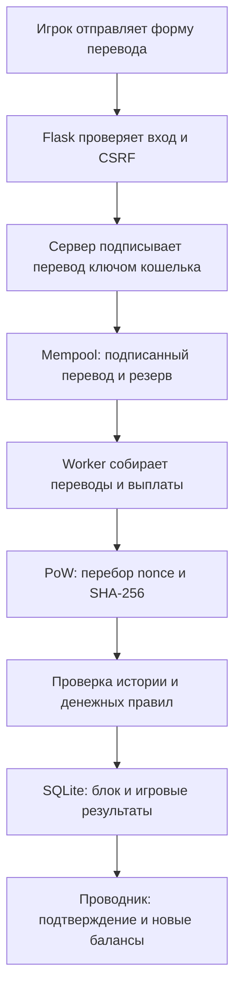

# Блокчейн OilCoin: от ключа кошелька до проверенного блока

Это подробный разбор блокчейна, который действительно реализован в проекте. Здесь показаны формат данных, криптографические операции, денежные расчёты и путь платежа через приложение. Имена функций относятся к исходному коду OilCoin.

Для знакомства читайте разделы по порядку. Для разбора конкретного перевода начните с его жизненного цикла и числового примера. Для экспериментов используйте практикум в конце: он создаёт отдельную цепочку в памяти и не меняет рабочую базу.

[Общая архитектура приложения](ARCHITECTURE.md) · [Кошелёк в интерфейсе](USER_GUIDE.md) · [HTTP API](API.md)

## 1. Что именно хранит блокчейн

OilCoin хранит последовательность блоков. Внутри блока находятся операции с монетой OIL: переводы, награда за добычу и выплата комиссий. Каждый следующий блок содержит хеш предыдущего, поэтому изменение старой записи нарушает связь истории.

Правила отвечают на четыре отдельных вопроса:

1. **Кто разрешил перевод?** Это проверяет цифровая подпись Ed25519.
2. **Совпадают ли данные с записанным блоком?** Это проверяет SHA-256.
3. **Выполнена ли вычислительная работа?** Это проверяет условие Proof-of-Work.
4. **Можно ли было потратить эту сумму и начислить такие выплаты?** Это проверяет повторный расчёт истории валидатором.

OilCoin использует модель счетов: у адреса есть баланс и последовательность исходящих переводов. Баланс получается из истории, отдельного редактируемого поля «остаток OIL» в аккаунте нет. Модель UTXO, в которой расходуются отдельные выходы предыдущих транзакций, здесь не используется.

Нефть, топливо, детали, карты, энергия, планировка острова и результаты боёв хранятся в игровых таблицах SQLite. Их состояние рассчитывает сервер. Блокчейн подтверждает связанные **денежные платежи**, например оплату сундука или строительства.

## 2. Как связаны основные части



SQLite хранит блоки; она не подбирает `nonce` и не проверяет Ed25519 вместо Python-кода. Flask принимает запросы; он не является алгоритмом блокчейна. Worker запускает вычисления; название этого процесса не означает наличие внешнего майнера.

Основная реализация находится в `blockchain.py`. Ключи и подписи — в `wallet.py`, аккаунты — в `accounts.py`, сохранение — в `storage.py`, автоматический шаг — в `engine.py`.

## 3. Как создаётся кошелёк

`wallet.generate_wallet_keys()` создаёт случайный приватный ключ Ed25519 и получает из него публичный ключ.

| Объект | Представление в проекте | Назначение |
|---|---|---|
| Приватный ключ | 32 байта, записанные как 64 шестнадцатеричных символа | Создавать подписи |
| Публичный ключ | 32 байта, записанные как 64 шестнадцатеричных символа | Проверять подписи и вычислять адрес |
| Адрес | `OIL_` и 32 строчных шестнадцатеричных символа | Указывать отправителя и получателя |
| Подпись | 64 байта, записанные как 128 шестнадцатеричных символов | Подтверждать конкретное сообщение |

Адрес вычисляется так:

```text
public_key_bytes = bytes.fromhex(public_key)
digest = SHA256(public_key_bytes).hexdigest()
address = "OIL_" + digest[:32]
```

Хешируется исходный набор байтов публичного ключа, а не текст его шестнадцатеричной записи. Урезанные 32 символа соответствуют 128 битам адреса. Адрес не является полным публичным ключом и не содержит контрольной суммы для обнаружения опечаток.

Проверка `is_valid_address()` проверяет **формат**. Адрес правильного формата может не принадлежать зарегистрированному аккаунту. Протокол допускает перевод на такой адрес; наличие получателя в базе аккаунтов не является правилом валидатора. Если соответствующего приватного ключа нет, потратить полученные монеты будет невозможно.

## 4. Пароль, ключ и серверная сессия

При регистрации `accounts.new_wallet_account()` создаёт ключи, сохраняет scrypt-хеш пароля и шифрует приватный ключ через Fernet. В таблице `accounts` лежит `encrypted_private_key`, а не открытый приватный ключ.

Ключ Fernet получается из серверного `SECRET_KEY`:

```text
key_material = SHA256(UTF8(SECRET_KEY + ":oilcoin-wallet-v1")).digest()
fernet_key = base64.urlsafe_b64encode(key_material)
```

Пароль нужен для входа в аккаунт. Он не используется как приватный ключ Ed25519 и не является источником ключа Fernet. После входа серверная сессия определяет адрес пользователя. При переводе сервер расшифровывает приватный ключ этого аккаунта и подписывает сообщение.

Такая схема называется **custodial**: ключами управляет приложение. Браузер не подписывает перевод самостоятельно. Оператор, имеющий базу и `SECRET_KEY`, технически может использовать ключи аккаунтов. Шифрование защищает отдельно полученную копию базы, но не делает работающий сервер недоверенным посредником.

Три механизма защищают разные действия:

| Механизм | Что проверяет |
|---|---|
| Пароль и сессия | Кто вошёл в веб-приложение |
| CSRF-токен | Допустим ли запрос в рамках текущей сессии |
| Подпись Ed25519 | Подписаны ли конкретные поля перевода соответствующим ключом |

Пароли, их хеши и приватные ключи не включаются в блоки или публичный API. История переводов, адреса, публичные ключи и подписи доступны в проводнике.

## 5. Почему SHA-256 и Ed25519 нужны одновременно

SHA-256 превращает произвольные байты в 256-битный результат: 32 байта или 64 шестнадцатеричных символа. Одинаковые байты дают одинаковый хеш. Изменение данных с очень высокой вероятностью даёт другой результат. Хеш не является шифрованием: из него нельзя «расшифровать» исходный блок.

Любой посетитель, имеющий данные блока, может пересчитать SHA-256. Поэтому один только хеш не доказывает, что отправитель разрешил перевод. Злоумышленник тоже способен поменять получателя и вычислить новый хеш.

Ed25519 решает другую задачу. Приватный ключ создаёт подпись сообщения; публичный ключ проверяет её. Подмена подписанного поля делает проверку подписи неуспешной. Подпись не скрывает сумму или получателя: они остаются открытыми.

В проекте криптографические примитивы предоставляет библиотека `cryptography`. Код OilCoin задаёт формат сообщения и правила его проверки, а не реализует арифметику Ed25519 вручную.

## 6. Как деньги превращаются в целые числа

Минимальная единица равна `0.00000001 OIL`. Константа `ATOMIC_UNITS` равна `100_000_000`:

```text
1 OIL          = 100 000 000 units
10 OIL         = 1 000 000 000 units
0.01 OIL       = 1 000 000 units
0.00000001 OIL = 1 unit
```

`to_units()` разбирает значение через `Decimal(str(value))` и возвращает целое число. Денежные проверки, резервы, комиссии и балансы считаются в этих целых единицах. Это исключает накопление ошибок вида `0.1 + 0.2` при арифметике двоичных дробей.

Число должно быть конечным и точно выражаться в units. Девятый ненулевой знак после запятой отклоняется, а не округляется. Также отклоняются `bool`, `NaN`, бесконечность и величины вне поддерживаемого диапазона. Нули в конце дробной части не меняют точность: `1.230000000` допустимо, `1.230000001` — нет.

`from_units()` возвращает число для JSON и интерфейса. В подписываемом сообщении используются целые `amount_units`, `fee_units` и `burn_units`; форматирование суммы на экране не определяет содержание подписи.

## 7. Что находится в обычном переводе

У операции типа `transfer` строго определены поля. Проверка подписи отвергает как отсутствующие, так и лишние поля.

| Поле | Смысл |
|---|---|
| `type` | `transfer` |
| `version` | Версия формата подписанного перевода, сейчас `1` |
| `sender` | Адрес отправителя |
| `recipient` | Адрес получателя |
| `amount` | Сумма, которую получит адресат |
| `fee` | Комиссия, которую отправитель оплатит сверх суммы |
| `burn` | Часть комиссии, которая исчезнет из обращения |
| `timestamp` | Время создания с указанием часового пояса |
| `sequence` | Следующий номер исходящего перевода отправителя |
| `network_id` | Хеш genesis этой цепочки |
| `public_key` | Публичный ключ отправителя |
| `signature` | Подпись канонического сообщения |
| `tx_id` | SHA-256 сообщения вместе с байтами подписи |

Сумма должна быть положительной, комиссия — неотрицательной. Переводы самому себе запрещены. Обычный перевод допускает комиссию `0`; отдельные игровые покупки задают свою комиссию по правилам игры.

`burn` рассчитывает узел: `fee_units // 2`. Пользователь не может произвольно выбрать эту величину.

## 8. Какие байты подписывает сервер

Подпись вычисляется не над произвольным JSON из браузера. `_transfer_payload()` создаёт отдельный объект с фиксированными полями:

```python
{
    "domain": "oilcoin-transfer-v1",
    "version": tx["version"],
    "network_id": tx["network_id"],
    "sender": tx["sender"],
    "recipient": tx["recipient"],
    "amount_units": to_units(tx["amount"]),
    "fee_units": to_units(tx["fee"]),
    "burn_units": to_units(tx["burn"]),
    "sequence": tx["sequence"],
    "timestamp": tx["timestamp"],
    "type": tx["type"],
    "public_key": tx["public_key"],
}
```

`domain` отделяет этот тип сообщения от других возможных подписываемых данных. `network_id` связывает его с сетью, а `sequence` — с порядком операций одного отправителя.

Затем `_canonical()` превращает объект в байты:

```python
json.dumps(
    value,
    sort_keys=True,
    separators=(",", ":"),
    ensure_ascii=False,
    allow_nan=False,
).encode("utf-8")
```

Ключи сортируются, пробелы между элементами не добавляются, кодировка — UTF-8. Так два одинаковых объекта дают одинаковые байты независимо от порядка записи ключей в Python-словаре. Порядок элементов массива транзакций при этом сохраняется: перестановка переводов меняет блок.

Это конкретное правило сериализации Python в OilCoin. Оно не является реализацией универсального стандарта канонизации JSON. При переносе проверяющего кода на другой язык нужно воспроизвести те же байты: например, запись числа `10` и запись `10.0` могут дать разные хеши блока. Для суммы в подписываемом сообщении эта неоднозначность снимается переводом в целые units.

Подпись создаётся так:

```text
payload   = _transfer_payload(tx)
signature = Ed25519.sign(private_key, payload)
tx_id     = SHA256(payload + bytes.fromhex(signature)).hexdigest()
```

Сначала получается подпись, затем идентификатор. `signature` и `tx_id` не входят в само подписываемое сообщение: иначе возникла бы зависимость результата от самого себя. Но валидатор пересчитывает `tx_id`, поэтому произвольно заменить идентификатор тоже нельзя.

Для системных выплат идентификатор создаётся отдельно из случайного UUID. Не нужно применять формулу идентификатора подписанного перевода к `mining_reward` или `miner_fee`.

## 9. Что проверяет подпись, а что — правила перевода

`verify_transaction_signature()` проверяет точный набор полей, версию, связь публичного ключа с адресом, Ed25519-подпись и соответствие `tx_id` содержимому.

`Blockchain._validate_transfer()` дополнительно проверяет формат адресов, сумму, комиссию, burn, время, положительный целый `sequence` и совпадение `network_id` с текущей цепочкой.

Достаточность средств и очередность `sequence` проверяются уже при обходе mempool или блоков. **Правильная подпись сама по себе не означает, что перевод можно принять:** владелец ключа способен подписать сумму больше своего баланса.

Отправитель не задаётся через доверенное поле формы. Маршрут `/transaction` берёт его из сессии; `add_transaction()` также проверяет, что переданный приватный ключ действительно соответствует этому адресу.

## 10. Sequence, tx_id и защита от повторов

`sequence` — счётчик исходящих переводов конкретного адреса. Если последний подтверждённый перевод имеет номер `3`, а в очереди уже есть номера `4` и `5`, следующий получит `6`.

Проверка требует точной последовательности `1, 2, 3, ...`, без пропусков и повторов. Счётчик не увеличивается при получении монет, награды или комиссии: учитываются исходящие `transfer`.

`tx_id` должен быть уникален среди всех операций цепочки и очереди. Если уже подтверждённую операцию вернуть в mempool, она будет отвергнута. Новый идентификатор при неизменном сообщении не помогает: проверка обнаружит несоответствие его хешу. Изменение `sequence` требует новой подписи и всё равно проверяется относительно истории.

Не путайте три разных числа:

| Значение | Что считает |
|---|---|
| `sequence` | Исходящие переводы одного адреса |
| `nonce` блока | Попытки найти подходящий хеш |
| `network_nonce` genesis | Случайное значение при создании новой сети |

## 11. Genesis и идентичность сети

Первый блок имеет `index = 0`, `previous_hash = "0"`, `nonce = 0` и одну операцию `genesis`. Её отправитель — `SYSTEM`, получатель — `GENESIS`, сумма, комиссия и burn равны нулю. Она не создаёт стартовый баланс игрока.

Новый genesis содержит `network_nonce`, полученный из случайного UUID, и объект `consensus`:

| Параметр | Назначение |
|---|---|
| `protocol` | `oilcoin-signed-v1` |
| `difficulty` | Требуемое число ведущих нулей в хеше |
| `mining_reward_units` | Размер обычной награды в units |
| `max_supply_units` | Максимальный совокупный выпуск |
| `atomic_units` | Число units в одном OIL |

Случайное значение входит в содержимое genesis и его хеш. `network_id` равен именно этому хешу. Поэтому две независимо созданные базы являются разными сетями, даже если их денежные настройки совпадают.

Перевод из одной сети нельзя просто перенести в другую: валидатор проверяет `network_id`, который защищён подписью. Копия той же цепочки сохраняет тот же идентификатор сети; backup не создаёт новую сеть.

Genesis хешируется, но для него не требуется PoW с ведущими нулями. Это начальная точка проверки, а не обычный добытый блок. Для новых цепочек валидатор сверяет настройки с `consensus` внутри genesis. В коде оставлена совместимость с более старыми genesis без этого поля; остальные правила проверки продолжают действовать.

## 12. Жизненный цикл платежа

Упрощённый путь перевода `A → B`:

1. Игрок входит и отправляет получателя, сумму и комиссию.
2. Flask проверяет сессию и CSRF, начинает SQL-транзакцию записи и загружает проверенную цепочку.
3. `add_transaction()` проверяет ключ, правила перевода и доступные средства.
4. Сервер задаёт время, burn, `sequence`, `network_id`, создаёт подпись и `tx_id`.
5. Операция добавляется в `pending_transactions` и сохраняется в SQLite. У отправителя появляется резерв.
6. Worker выбирает получателя награды, собирает блок и выполняет PoW.
7. Перевод становится частью подтверждённой истории; очередь очищается, балансы и выпуск изменяются.
8. Блок и связанные результаты игры сохраняются одной SQL-транзакцией. После commit состояние доступно следующим запросам.

Положительный ответ на создание перевода означает принятие в очередь. Подтверждение появляется при включении в сохранённый блок. Если worker остановлен, сама веб-страница может продолжать открываться, а платежи будут ждать.

## 13. Mempool и резерв средств

Mempool — очередь подписанных, ещё не подтверждённых переводов. В коде это список `pending_transactions`, на диске — одноимённая таблица. Перезапуск приложения не должен терять очередь.

Для адреса рассчитываются:

```text
confirmed = баланс по записанным блокам
reserved  = сумма(amount + fee) всех исходящих pending-переводов
available = confirmed − reserved
```

Если на счёте 50 OIL, а один перевод резервирует 30, следующий может потратить максимум оставшиеся 20 с учётом своей комиссии. Проверка пула суммирует резервы отправителя; два перевода не могут использовать одни и те же деньги.

Ожидаемый входящий перевод не добавляет доступных средств. Если у B пока `0 OIL`, pending-перевод `A → B` на 30 не позволит B отправить 1 OIL дальше. Нужно сначала дождаться блока.

Пул проверяется в сохранённом порядке. Комиссия не используется для сортировки и не ускоряет подтверждение: текущая реализация включает все допустимые переводы очереди. При недопустимом элементе майнинг отказывается менять цепочку; автоматического выбрасывания ошибочных записей не предусмотрено. Пользовательская отмена и замена pending-перевода тоже не реализованы.

## 14. Что содержит блок

Новые блоки используют формат `version = 2`:

| Поле | Смысл | Входит в хеш v2 |
|---|---|---|
| `version` | Версия формата хеширования | Да |
| `index` | Позиция в цепочке: 0, 1, 2, ... | Да |
| `timestamp` | Время формирования блока | Да |
| `transactions` | Полный упорядоченный список операций | Да |
| `previous_hash` | Хеш предыдущего блока | Да |
| `nonce` | Целый неотрицательный счётчик PoW | Да |
| `hash` | Результат SHA-256 | Нет |
| `mining_started_at` | Время начала вычисления | Нет |
| `mining_finished_at` | Время окончания вычисления | Нет |
| `mining_duration_seconds` | Измеренная длительность вычисления | Нет |

`Block.calculate_hash()` собирает первые шесть полей, сериализует их через `_canonical()` и вычисляет SHA-256. Поле `hash` не входит само в себя. Служебное время вычисления не является частью криптографически защищённого содержимого блока.

Все переводы включаются в хеш целиком. Отдельного дерева Меркла, Merkle root, заголовка Bitcoin и доказательства включения одной транзакции здесь нет. Для пересчёта хеша нужен полный набор операций блока.

Время записи должно иметь часовой пояс. Валидатор не доказывает правильность серверных часов, не требует строгого роста времени между блоками и не использует независимый источник времени. Порядок истории задаётся `index` и связями хешей.

## 15. Как работает Proof-of-Work

Сложность `d` означает требование:

```text
block.hash.startswith("0" * d)
```

При `d = 3` подходят хеши, начинающиеся с `000`. Это три **шестнадцатеричных** нуля, то есть 12 нулевых битов. Подходит и хеш с большим числом ведущих нулей.

```python
hash_value = block.calculate_hash()
while not hash_value.startswith("0" * difficulty):
    block.nonce += 1
    hash_value = block.calculate_hash()
```

Для каждого нового `nonce` меняются байты блока и получается новый хеш. Обратной формулы для подходящего `nonce` нет; узел перебирает кандидатов. Проверяющий делает один пересчёт SHA-256 и проверяет префикс: проверить результат обычно проще, чем найти его.

Если считать результаты SHA-256 равномерными, вероятность успеха одной попытки равна `16^(-d)`, а среднее число попыток — `16^d`:

| Сложность | Среднее число попыток |
|---|---|
| 1 | 16 |
| 2 | 256 |
| 3 | 4 096 |
| 4 | 65 536 |

Это среднее, а не гарантированный предел. Подходящий хеш иногда находится уже при `nonce = 0`, иногда требует значительно больше попыток. Повышение сложности на один ноль увеличивает ожидаемую работу в 16 раз.

Класс `Blockchain` допускает сложности 1–6; конфигурация веб-приложения ограничивает начальную сложность диапазоном 1–4. По умолчанию при загрузке новой базы приложения используется 3. Правила существующей цепочки сохраняются в базе и новом genesis; изменение переменной окружения не пересчитывает старые блоки. Автоматической подстройки сложности нет.

## 16. Кто получает награду и почему блоки идут с интервалом

PoW считает процесс worker на CPU сервера. Устройства игроков не выполняют соревнование по хешрейту. Получатель выплаты выбирается в `engine.step()` до майнинга.

Worker рассматривает обычные аккаунты, активные за последние 120 секунд, и обычные аккаунты, отправившие pending-переводы. Адреса сортируются; выбирается следующий после последнего получателя, а при достижении конца — первый. Для некоторых случаев с ожидающими платежами предусмотрен выбор первого обычного аккаунта.

Константа `BLOCK_INTERVAL = 30` задаёт минимальный интервал запуска автоматических блоков. При отсутствии подходящих участников новый автоматический блок не создаётся. Остановка worker, нагрузка и время вычислений могут увеличить ожидание. «Раз в 30 секунд» не означает точное расписание или обязательную выплату каждому игроку.

Это **правило приложения**. Валидатор цепочки проверяет допустимость адреса выплат и совпадение получателей награды и комиссии, но не пересчитывает активность аккаунтов и справедливость ротации. Время 30 секунд также не является условием PoW-валидатора. Лабораторный ручной майнинг может создавать блоки без этого расписания; по умолчанию в игре он отключён.

Улучшение оборудования кошелька увеличивает игровой XP. Оно не меняет сложность, размер OIL-награды или реальную вычислительную мощность сервера.

## 17. Как собирается кандидат блока

`mine_pending_transactions()` сначала проверяет существующую цепочку, адрес получателя выплат и mempool. Затем:

1. Суммирует burn всех ожидающих переводов.
2. Суммирует `fee − burn` для выплаты майнеру.
3. Вычисляет допустимую новую эмиссию.
4. Копирует все pending-переводы в прежнем порядке.
5. Добавляет `mining_reward`, если размер награды больше нуля.
6. Добавляет `miner_fee`, если остаток комиссий больше нуля.
7. Создаёт блок с `index = len(chain)` и `previous_hash` последнего блока.
8. Подбирает `nonce`, добавляет блок в память, увеличивает накопленный burn и очищает mempool.

`save_blockchain()` проверяет результат перед сохранением. До завершения SQL-транзакции изменение объекта в памяти ещё не является устойчиво записанным состоянием.

Переводы стоят перед системными выплатами. Награду текущего блока нельзя использовать для финансирования перевода в этом же блоке. Ограничения размера блока или числа операций и выбор части очереди в текущем алгоритме не заданы.

## 18. Системные операции и выпуск монет

Разрешены только четыре типа операций:

| Тип | Назначение | Создаёт новые OIL |
|---|---|---|
| `genesis` | Нулевая начальная запись | Нет |
| `transfer` | Перемещение монет между адресами | Нет |
| `mining_reward` | Выпуск награды за блок | Да |
| `miner_fee` | Передача оставшейся части комиссий майнеру | Нет |

У выплат `sender = "SYSTEM"`. `SYSTEM` и `GENESIS` — служебные обозначения, а не обычные кошельки `OIL_…`. Системные выплаты не подписываются пользовательским ключом. Валидатор разрешает их только в размере и количестве, соответствующих правилам блока.

При обычных настройках:

```text
reward = min(50 OIL, 1 000 000 OIL − minted)
```

Если осталось выпустить 20 OIL, следующая награда равна 20, а не 50. После достижения лимита `mining_reward` отсутствует. Комиссии и новые подтверждения остаются возможными; при нулевых комиссиях блок может не содержать системных выплат.

`minted` — сумма всех операций `mining_reward` с начала истории. Halving, самостоятельное увеличение эмиссии за покупку, выпуск OIL за PvP и возврат лимита после burn не предусмотрены.

## 19. Комиссия, burn и казначейство

Для перевода суммы `a` с комиссией `f`:

```text
отправитель теряет a + f
получатель получает a
burn = fee_units // 2
майнер получает fee_units − burn_units
```

Burn не отправляется на специальный адрес: часть списанной комиссии не зачисляется никому, а прибавляется к `burned_supply`.

Для нечётной комиссии в минимальных единицах округление идёт вниз. При `fee = 3 units` сгорает `1 unit`, майнер получает `2 units`. Расчёт выполняется **для каждого перевода**, затем результаты суммируются. Две комиссии по 1 unit дают нулевой общий burn и 2 units майнеру; это отличается от деления суммарной комиссии пополам.

Платёж игровому казначейству — обычный `transfer`. Его сумма остаётся балансом адреса казначейства и входит в обращение. Только поле `burn` комиссии уменьшает общее число обращающихся монет. Расход OIL игроком и протокольное сжигание — разные события.

## 20. Полный числовой пример

Создадим новую цепочку и два адреса A и B. Genesis даёт обоим нулевой баланс. Первый добытый блок начисляет 50 OIL адресу A. Затем A переводит B 10 OIL с комиссией 2. Получателем награды второго блока выберем B.

| Этап | Подтверждено у A | Резерв A | Доступно A | Подтверждено у B | Выпущено | Сожжено | В обращении |
|---|---|---|---|---|---|---|---|
| Genesis | 0 | 0 | 0 | 0 | 0 | 0 | 0 |
| Блок 1: награда A | 50 | 0 | 50 | 0 | 50 | 0 | 50 |
| Перевод в mempool | 50 | 12 | 38 | 0 | 50 | 0 | 50 |
| Блок 2: подтверждение, майнер B | 38 | 0 | 38 | 61 | 100 | 1 | 99 |

Блок 2 содержит три операции в таком порядке:

```text
transfer:      A → B, amount = 10, fee = 2, burn = 1
mining_reward: SYSTEM → B, amount = 50
miner_fee:     SYSTEM → B, amount = 1
```

Проверка арифметики:

```text
A = 50 − 10 − 2 = 38
B = 0 + 10 + 50 + 1 = 61
minted = 50 + 50 = 100
burned = 1
circulating = 100 − 1 = 99
A + B = 38 + 61 = 99
```

Если второй блок получит A, итог будет другим: A получит `38 + 50 + 1 = 89`, B — 10. Общая сумма останется 99. При наблюдении рабочей игры нужно учитывать все автоматически появившиеся блоки и их получателей, а не только сам перевод.

## 21. Как валидатор заново вычисляет историю

`Blockchain._validate_chain()` начинает с пустых балансов, нулевых sequence, пустого множества идентификаторов и нулевого выпуска. Дальше он идёт от genesis к последнему блоку.

Для каждого блока проверяются версия, точный `index`, неотрицательный целый `nonce`, формат времени и список операций. Хеш пересчитывается по содержимому. Для обычного блока проверяются связь с предыдущим и требуемые ведущие нули.

Каждая операция должна иметь разрешённый тип и уникальный идентификатор. Суммы переводятся в units. Genesis проверяется отдельно. Для каждого перевода проверяются подпись, сеть, burn и последовательность номера; текущий баланс отправителя должен покрывать `amount + fee`.

После допустимого перевода состояние обновляется:

```text
balances[sender] -= amount_units + fee_units
balances[recipient] += amount_units
sequences[sender] += 1
```

В конце блока валидатор проверяет точное количество и размер системных выплат. До лимита должна быть одна правильная награда; при ненулевом остатке комиссий — одна правильная выплата комиссии. Если есть обе выплаты, их получатель должен совпадать. После начала системных выплат обычный перевод в том же блоке запрещён.

После выплат проверяется денежное равенство:

```text
sum(всех балансов) = minted − burned
```

В конце всей истории пересчитанный burn сверяется с `burned_supply` из состояния. Поэтому недостаточно сохранить «красивый» хеш: история должна согласовываться с денежными правилами на каждом шаге.

Повторный расчёт блоков допускает использование ранее зачисленных средств в порядке операций. Приём mempool строже: он не позволяет создавать перевод за счёт входящего pending-платежа. Эти две проверки применяются на разных этапах.

## 22. Что происходит при подмене данных

| Изменение | Почему проверка отвергает его |
|---|---|
| Поменять сумму в сохранённом блоке | Пересчитанный хеш не совпадёт с сохранённым |
| Поменять сумму и заново добыть блок | Подпись перевода и его `tx_id` не соответствуют сообщению |
| Пересчитать `tx_id` без правильной подписи | Ed25519-проверка всё равно не пройдёт |
| Подписать перевод с превышением баланса | Проверка средств при обходе истории или mempool отвергнет трату |
| Вернуть подтверждённый перевод в очередь | Повторится идентификатор и нарушится sequence |
| Перенести перевод в другую сеть | Подписанный `network_id` не совпадёт с genesis |
| Добавить лишнюю награду | Количество или сумма системных выплат нарушит правило эмиссии |
| Изменить старый блок | Изменится его хеш, а следующий блок продолжит ссылаться на прежний |
| Изменить только длительность майнинга | Это служебное поле не входит в хеш v2; такая подмена хешем не обнаруживается |

Чтобы восстановить связи после изменения старого блока, пришлось бы пересчитать последующие блоки и заново выполнить их PoW. Это всё равно не отменяет подписи и денежные ограничения.

Однако оператор единственного сервера контролирует код, ключи и базу. Он может создать другую внутренне согласованную историю или изменить проверяющую программу. Здесь нет независимых узлов, которые сохраняют исходную копию и разрешают конфликт. Локальная валидация обнаруживает нарушение заданных правил, но не доказывает абсолютную неизменность перед владельцем сервера.

## 23. Как цепочка сохраняется в SQLite

`storage.load_blockchain()` читает сетевые настройки из `chain_state`, блоки из `blocks` по высоте и очередь из `pending_transactions` по позиции. Для блоков отдельно сверяются высота и хеш SQL-строки с JSON внутри неё; для очереди — идентификатор строки с `tx_id` объекта.

Затем выполняются полная проверка цепочки и проверка mempool. При повреждении загрузка завершается ошибкой. Приложение не заменяет повреждённую историю пустой цепочкой. Новая цепочка создаётся только при отсутствии состояния и сохранённых блоков.

`save_blockchain()` проверяет данные ещё раз. Через этот метод нельзя укоротить подтверждённую цепочку или заменить хеш уже сохранённого блока на той же высоте. Очередь сохраняется в актуальном порядке, а сетевые параметры и накопленный burn обновляются.

Это ограничения штатного кода сохранения. SQLite-файл сам по себе не защищён от человека с правом прямой записи в него. Хеши блоков не заменяют права доступа, резервные копии и защиту серверного секрета.

## 24. Как предотвращаются параллельные траты и частичные выдачи

HTTP POST начинает `BEGIN IMMEDIATE` **до загрузки состояния**. SQLite допускает одного writer: второй запрос ждёт, затем читает уже обновлённую очередь и резервы. Поэтому два одновременных запроса не должны независимо потратить один доступный остаток.

GET использует транзакцию чтения и получает согласованный снимок. База работает в WAL; вложенные `unit_of_work()` используют активное соединение вместо отдельного независимого commit.

Фоновый шаг тоже выполняется внутри SQL-транзакции записи. Подтверждение блока, запуск оплаченной стройки, доставка рынка и открытие оплаченного сундука используют ту же транзакцию. Ошибка до commit откатывает блок и связанные изменения вместе. После остановки процесса сохранённое состояние позволяет повторить незавершённый шаг.

Это объясняет важное различие: перевод подтверждает оплату, а конкретный игровой результат выдаёт Python-код по связанному `tx_id`. Атомарная запись не превращает эту логику в публичный смарт-контракт.

На время PoW writer остаётся занят. Чтение и проверка всей цепочки при большинстве запросов, отсутствие ограничения размера блока и сериализация записей ограничивают масштабирование. Эти свойства нужно учитывать при увеличении числа игроков и длины истории.

## 25. Подтверждение, консенсус и границы модели

В интерфейсе `pending` означает очередь, `confirmed` — наличие операции в записанном блоке. Дополнительные блоки позволяют видеть продолжение истории. Но вероятностная оценка отката через «шесть подтверждений» для Bitcoin здесь не применима: независимого соревнования ветвей нет.

В OilCoin реализованы подписанные переводы, связанная хешами история, настоящий перебор PoW, денежная валидация и устойчивое хранение. Многопользовательская игра работает поверх одного узла.

Полный распределённый консенсус потребовал бы обмена блоками между независимыми узлами, проверки входящих ветвей, выбора цепи по заданному правилу и обработки реорганизации. В текущем проекте нет P2P, fork choice, накопленной работы ветвей, reorg и внешних майнеров. PoW здесь показывает вычислительное доказательство для локального блока.

| Свойство | Реализация OilCoin |
|---|---|
| Модель денег | Балансы адресов и последовательность переводов |
| Подписи | Ed25519, ключи на сервере |
| Хеширование | SHA-256 полного содержимого блока v2 |
| Поиск блока | Подбор ведущих нулей через nonce |
| Выбор получателя награды | Серверная ротация, отдельно от PoW |
| Передача истории | HTTP API и проводник, без P2P |
| Выполнение игры | Python и SQLite, без публичной виртуальной машины |
| Хранение | JSON-объекты внутри SQL-таблиц |

## 26. Версии, которые нельзя смешивать

| Версия | Что описывает |
|---|---|
| `Block.version = 2` | Канонический JSON для хеша новых блоков |
| `transfer.version = 1` | Формат подписанного перевода |
| `oilcoin-signed-v1` | Обозначение протокола в новом genesis |
| `schema_version = 5` | Структура таблиц SQLite |

Для старых блоков `version = 1` используется прежняя формула: конкатенация индекса, времени, сериализованного массива транзакций, предыдущего хеша и nonce. Новые блоки используют объект с явными полями. Валидатор понимает оба формата; существующие хеши не заменяются хешами v2.

Миграция схемы базы не означает повторный майнинг всей истории. Изменение структуры хранения и изменение протокола хеширования — отдельные операции.

## 27. Практикум: создать, подтвердить и повредить перевод

Следующий код запускается из корня проекта в Python-окружении с установленными зависимостями. Он создаёт новые ключи и цепочку **только в памяти**; не импортирует Flask-приложение и не открывает рабочую SQLite. Сложность 1 выбрана для быстрого опыта. В рабочем интерфейсе получателя награды выбирает worker; здесь его задаём явно для воспроизводимого расчёта.

Сохраните код во временный файл или выполните в Python. Закрытые ключи не печатаются, адреса и хеши будут различаться при каждом запуске.

```python
import copy
import hashlib
import json

from blockchain import Blockchain, _transfer_payload, verify_transaction_signature
from wallet import generate_wallet_keys, verify_signature

a = generate_wallet_keys()
b = generate_wallet_keys()
chain = Blockchain(difficulty=1)

ok, message, _ = chain.mine_pending_transactions(a["address"])
assert ok, message
ok, message = chain.add_transaction(
    a["address"], b["address"], "10", "2", private_key=a["private_key"]
)
assert ok, message

tx = copy.deepcopy(chain.pending_transactions[0])
payload = _transfer_payload(tx)
assert verify_signature(tx["public_key"], tx["signature"], payload)
assert tx["tx_id"] == hashlib.sha256(
    payload + bytes.fromhex(tx["signature"])
).hexdigest()
assert verify_transaction_signature(tx)

print("До блока:", chain.get_balance(a["address"]),
      chain.get_reserved_pending(a["address"]), chain.get_balance(b["address"]))

ok, message, block = chain.mine_pending_transactions(b["address"])
assert ok, message
assert block.previous_hash == chain.chain[-2].hash

# Независимо пересчитаем байты и хеш блока v2.
fields = ("version", "index", "timestamp", "transactions", "previous_hash", "nonce")
block_payload = {name: getattr(block, name) for name in fields}
raw = json.dumps(block_payload, sort_keys=True, separators=(",", ":"),
                 ensure_ascii=False, allow_nan=False).encode("utf-8")
assert hashlib.sha256(raw).hexdigest() == block.hash
assert block.hash.startswith("0" * chain.difficulty)

assert chain.get_balance(a["address"]) == 38
assert chain.get_balance(b["address"]) == 61
assert chain.get_reserved_pending(a["address"]) == 0
assert chain.calculate_total_supply() == 100
assert chain.burned_supply == 1
assert chain.calculate_circulating_supply() == 99
assert chain.is_chain_valid()[0]
print("После блока: A=38, B=61, выпуск=100, burn=1, обращение=99")

# Сделаем отдельную повреждённую копию последнего блока.
damaged = Blockchain.from_dict(chain.to_dict())
damaged.chain[-1].transactions[0]["amount"] = 11.0
assert not damaged.is_chain_valid()[0]
print("Подмена суммы:", damaged.is_chain_valid()[1])

# Выполним новый PoW: правильный хеш не исправляет чужую подпись.
damaged.chain[-1].mine_block(damaged.difficulty)
assert not damaged.is_chain_valid()[0]
print("Подмена после нового PoW:", damaged.is_chain_valid()[1])

assert chain.is_chain_valid()[0]  # Исходная цепочка осталась целой.
```

Ожидаемые постоянные части вывода:

```text
До блока: 50.0 12.0 0.0
После блока: A=38, B=61, выпуск=100, burn=1, обращение=99
```

При первой подмене проверка сообщит о неправильном хеше блока. После повторного PoW — о неправильной подписи или идентификаторе перевода. Так можно увидеть, что хеш, PoW и подпись проверяют разные свойства.

## 28. Как проследить это в приложении

Откройте [проводник](/explorer). Найдите платёж по `tx_id` и сравните отправителя, получателя, сумму, комиссию, burn, публичный ключ, подпись, sequence и сеть. Затем откройте содержащий его блок: проверьте номер, `previous_hash`, nonce, хеш и системные выплаты.

Откройте [проверку цепочки](/validate). Она проверяет историю по правилам узла. Для независимого расчёта можно получить публичные данные через `GET /api/chain`; формат описан в [API](API.md). Для воспроизведения нужны genesis, все предшествующие блоки и параметры сети, а не только строка подписи последнего платежа.

Автоматические блоки продолжают появляться во время просмотра, поэтому сверяйте высоту снимка и получателей наград. Входящий перевод, собственная награда и комиссия майнера — отдельные записи, каждая меняет баланс по своему правилу.

## 29. Где находится реализация

| Этап | Реализация |
|---|---|
| Ключи, адрес и Ed25519 | `wallet.py` |
| Шифрование ключей, вход | `accounts.py`, маршруты `app.py` |
| Канонические байты и tx_id | `_canonical`, `_transfer_payload`, `_transfer_id` в `blockchain.py` |
| Денежные единицы и округление | `to_units`, `from_units` |
| Резерв и sequence | `add_transaction`, `validate_pending_transactions` |
| Хеш и служебные метаданные | `Block.calculate_hash` |
| Награды, burn и обход истории | `mine_pending_transactions`, `_validate_chain` |
| Сохранение и повреждённая база | `storage.py`, `database.py` |
| Автоматический шаг | `engine.step`, `worker.main` |
| Подтверждение игровых оплат | `district.py`, `market.py`, `chests.py` |

Практикум выше позволяет самостоятельно проверить подпись, пересчитать хеш и увидеть отказ валидатора на подменённой истории.
